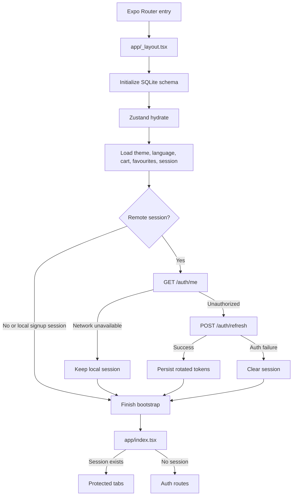

# Developer Guide

This guide explains how Morrow Market is wired together, where each responsibility lives, and how to trace common user actions through the code. Read it alongside the app; the route files are the best starting point when following a screen interaction.

## 1. Mental Model

Think of the app as four layers:

1. **Routes and screens** in `app/` display UI, collect input, and call application actions.
2. **Application state and workflows** in `src/store/useAppStore.ts` coordinate authentication, cart, favourites, and preferences.
3. **Infrastructure services** in `src/services/` talk to DummyJSON and platform session storage.
4. **Persistence** in `src/db/` owns the SQLite schema and repository operations.

A typical write follows this path:

```text
User action
  -> app route/screen
    -> Zustand action
      -> API service and/or SQLite repository
      -> Zustand state update
        -> subscribed screen re-renders
```

Screens should not write SQL or call `fetch` directly. Keep request construction in `api.ts`, and keep SQL in `repository.ts`.

## 2. Application Entry and Startup

`package.json` sets `main` to `expo-router/entry`. Expo Router discovers files in `app/`; `index.ts` and `App.tsx` are leftovers from the original blank template and are not the active entry point.

Startup proceeds like this:



The root layout waits for `bootstrapped` before mounting navigation. `app/index.tsx` redirects to either the auth group or tabs. `app/(tabs)/_layout.tsx` checks for a session again, so a direct URL to a protected tab is redirected to login. The auth layout redirects an existing user to tabs and rejects the OTP route if there is no pending signup.

## 3. Route Map

Expo Router route groups in parentheses organize navigation but do not become URL path segments.

| Screen / route | Responsibility |
| --- | --- |
| `app/index.tsx` | Startup redirect based on hydrated session |
| `app/(auth)/login.tsx` | Login form, validation, DummyJSON authentication |
| `app/(auth)/signup.tsx` | Signup form validation and account creation request |
| `app/(auth)/otp.tsx` | Test OTP input and verification feedback |
| `app/(tabs)/index.tsx` | Product catalog, search, categories, sorting, pagination |
| `app/product/[id].tsx` | Product details, cached fallback, reviews, quantity and purchase actions |
| `app/(tabs)/cart.tsx` | Local cart, quantity editing, remove/move, totals, remote cart calls |
| `app/(tabs)/favorites.tsx` | Local favourites, search, sort, add-to-cart |
| `app/(tabs)/settings.tsx` | Profile, theme, language/RTL, logout |

`app/_layout.tsx` owns the root stack, safe-area provider, status bar, theme background, database bootstrap, and application language/RTL setup. `app/(auth)/_layout.tsx` and `app/(tabs)/_layout.tsx` own group-level navigation and route guards.

## 4. Authentication Flow

### Login

Follow `login.tsx` -> `useAppStore.login()` -> `api.login()` -> `sessionStorage.write()` -> store update -> route replacement to tabs.

1. Login validates that username/password are present.
2. `api.login` sends `POST /auth/login` and asks DummyJSON for 30-minute token expiry.
3. The returned user and access/refresh tokens become an `AuthSession`.
4. The session is stored before Zustand is updated, then the route changes to `/(tabs)`.
5. A network error, server error, or invalid credential is translated into a visible message.

### Signup and test OTP

Follow `signup.tsx` -> `useAppStore.signup()` -> `api.signup()` -> OTP route -> `useAppStore.verifyOtp()` -> session storage -> tabs.

1. Signup validates required fields, email format, age, and matching passwords.
2. `POST /users/add` simulates account creation. DummyJSON does not send an email/SMS OTP and does not return real signup tokens.
3. The returned demo user is held in Zustand as `pendingSignup` with an expiry timestamp five minutes in the future. The password is not retained after the signup request.
4. OTP verification accepts only the literal test code `123456` before expiry.
5. A valid code creates a `demoSignup` local session; this session is not represented as a DummyJSON-authenticated token.
6. Resend resets the five-minute timer; it does not send a message.

Pending signup data is held in memory, not persisted. A full app reload during signup loses the pending OTP flow and the user must begin signup again. This test implementation is not production identity verification.

### Session restoration and logout

Remote login sessions are stored in SecureStore on iOS/Android and browser `localStorage` on web. On app startup, the store calls `/auth/me`; if validation fails, it attempts `/auth/refresh`. A network failure preserves the local session to allow offline use; a non-network refresh/auth failure clears it. Demo signup sessions skip remote token validation. Logout clears stored session data and the settings screen replaces navigation with login.

Relevant files: `src/store/useAppStore.ts`, `src/services/api.ts`, `src/services/session.ts`, and the auth route layouts/screens.

## 5. Catalog and Product Details

### Catalog request lifecycle

`app/(tabs)/index.tsx` owns the current query, category, sort mode, result list, loading states, and pagination cursor (derived from `products.length`). It calls `api.categories()` when the screen gets focus and calls `api.products()` when search/category/sort changes.

`api.products()` builds the DummyJSON route and `limit`/`skip` parameters. Each request uses a request ID so an older response cannot overwrite a newer search. Pages contain 10 products; `FlatList.onEndReached` requests the next page. Successful product pages are cached in SQLite. On network failure, the screen loads cached products and filters them locally for the active text query and category. An Expo Network listener triggers a refresh after connectivity returns.

The `ProductTile` component presents image, category, discount, rating, price, stock status, and a favourite button. It is shared by the catalog and favourites screens.

### Details

`app/product/[id].tsx` reads the route `id`, requests `GET /products/{id}`, caches the response, and falls back to cached products if offline. The product response supplies images, stock, minimum order quantity, warranty, return policy, shipping information, and reviews. Quantity is clamped in the UI and validated again by the Zustand cart action before persistence.

## 6. Cart and Favourites

Zustand holds the current in-memory cart/favourite arrays for rendering. SQLite is the durable source of truth across restarts. Store actions write the repository first, then update Zustand, so a successful UI state update corresponds to a completed local write.

### Cart action trace

```text
Details/Add button
  -> useAppStore.addToCart(product, quantity)
    -> validate minimumOrderQuantity and product.stock
    -> repository.saveCartLine(product, quantity)
      -> SQLite cart_items upsert
    -> update Zustand cart array
      -> cart screen re-renders and recalculates totals
```

Cart totals use the discounted unit price multiplied by quantity. The cart screen also reads a sample remote user cart when focused, and uses DummyJSON add/update/delete endpoints as best-effort remote interactions. Because these endpoints are simulated, remote failure never removes or replaces local cart data. “Continue to checkout” currently demonstrates the remote cart-create interaction; it is not a payment checkout.

### Favourites

The product tile calls `toggleFavorite`. That store action checks the ID, writes or deletes the favourite row, and updates the Zustand list. The favourites screen searches and sorts its local list, paginates the visible list in groups of ten, can add a saved item to the cart, and removes entries through the same product tile action.

## 7. Persistence Model

`src/db/database.ts` lazily opens `morrow-market.db` and creates tables. `src/db/repository.ts` is the only module that performs app-specific SQL.

| Table | Primary key | Purpose |
| --- | --- | --- |
| `cart_items` | `product_id` | Serialized product data plus positive quantity |
| `favorites` | `product_id` | Serialized product snapshot for offline use |
| `cached_products` | `product_id` | Product API responses used for offline list/details fallback |
| `preferences` | `key` | Theme and language values |

Session tokens are separate from SQLite and use platform session storage described above. This separation limits accidental exposure of auth secrets in the regular application database.

When adding a persisted field, update the schema in `database.ts`, implement read/write operations in `repository.ts`, add an action/type in `useAppStore.ts` if shared state is needed, then connect it from a screen. Keep migrations/versioning in the database layer if the schema evolves.

## 8. Theme, Translation, and RTL

- `src/theme/tokens.ts` defines light/dark color sets.
- `src/i18n/index.ts` contains English and Arabic resource strings and initializes i18next/react-i18next.
- `src/components/Screen.tsx` provides safe areas, shared page background, scrolling, and language-dependent direction.
- `src/components/Controls.tsx` provides shared buttons, fields, and section headings using theme tokens.
- `settings.tsx` persists preference changes through Zustand/SQLite.
- Arabic selection calls `I18nManager.forceRTL` and reloads the app so native navigation direction is recalculated. On web, direction and alignment also follow the current language in shared/screen layouts.

When adding visible text, add the same key to both `en.translation` and `ar.translation`, then render it with `t('key')`. Avoid hard-coded user-facing copy in route components.

## 9. Shared Components and Types

- `src/components/Controls.tsx`: `Button`, `Field`, and `SectionTitle`.
- `src/components/Screen.tsx`: common safe-area and content wrapper.
- `src/components/ProductTile.tsx`: reusable catalog/favourite product card.
- `src/types/index.ts`: product, review, user, session, cart, category, language, and theme contracts shared across layers.

When the backend response shape changes, update the types and API service first. Components and store actions should consume typed domain values rather than parse raw responses independently.

## 10. Libraries: What Each Is For

### App-facing libraries

| Library | Why it is here | Used in |
| --- | --- | --- |
| `expo-router` | File-based routes, stack/tab navigation, route groups, redirects, URL parameters | `app/` route files |
| `zustand` | Small shared state store and async app actions | `src/store/useAppStore.ts` |
| `expo-sqlite` | Durable relational persistence and cached products | `src/db/` |
| `expo-secure-store` | Secure native storage for login session/tokens | `src/services/session.ts` on iOS/Android |
| `i18next` | Translation engine and English fallback configuration | `src/i18n/index.ts` |
| `react-i18next` | React hooks such as `useTranslation()` | Route/components |
| `expo-image` | Efficient remote product images and image transitions | Product tile/details/cart |
| `expo-network` | Connectivity listener and catalog retry after reconnect | Catalog screen |
| `expo-updates` | Reload after changing native RTL direction | Settings screen |
| `lucide-react-native` | Consistent outline icons | Buttons, tabs, product and settings UI |
| `react-native-svg` | SVG renderer required by Lucide icons | Indirect icon rendering dependency |

### Platform and build support

| Library | Role |
| --- | --- |
| `expo` | Expo runtime, CLI integration, config plugins, Metro integration |
| `react` | Component model, hooks, and rendering state |
| `react-native` | Native UI primitives and platform APIs such as `Platform` and `I18nManager` |
| `expo-status-bar` | Theme-aware status bar in the root layout |
| `expo-linking` | Native URL/deep-link support used by Expo Router |
| `expo-localization` | Expo localization package is installed; current selected language is app preference-driven in SQLite |
| `expo-constants` | Expo runtime/config metadata package installed for Expo integrations |
| `react-native-safe-area-context` | Safe-area provider and inset-aware screen wrapper |
| `react-native-screens` | Native screen containers used by navigation |
| `react-native-gesture-handler` | Gesture infrastructure used by native navigation ecosystem |
| `react-native-reanimated` | Animation infrastructure supported by the Expo/RN setup |
| `react-native-web` and `react-dom` | Web renderer for React Native components |
| `typescript` and `@types/react` | Type checking and React type declarations |

Packages in the second table are not all directly imported by business code; some are installed because Expo Router, React Native, web support, or native navigation needs them. Use `npm ls <package>` to inspect a dependency’s installed relationship.

## 11. Where to Make Common Changes

| Change | Start here | Also check |
| --- | --- | --- |
| Add/modify an API endpoint | `src/services/api.ts` | Shared types, caller screen/store action |
| Change login/session policy | `src/store/useAppStore.ts` | `src/services/session.ts`, auth screens |
| Change OTP behavior | `src/store/useAppStore.ts` | `app/(auth)/otp.tsx`, README demo flow |
| Add a persisted field/table | `src/db/database.ts` | `src/db/repository.ts`, types/store |
| Change cart/favourite rules | `src/store/useAppStore.ts` | Cart and favourites screens |
| Add a translatable label | `src/i18n/index.ts` | Screen using the translation key |
| Change colors | `src/theme/tokens.ts` | Shared components and route layouts |
| Change route access/navigation | Group `_layout.tsx` files | `app/index.tsx` |
| Change the product card | `src/components/ProductTile.tsx` | Catalog and favourites screens |
| Change web WASM support | `metro.config.js` | `app.json` Router headers and hosting config |

## 12. Libraries and Commands at a Glance

```powershell
npm install
npm run typecheck
npx expo start
npx expo start --web
npx expo export --platform web
npx expo install --check
```

`metro.config.js` adds `.wasm` asset support and COOP/COEP headers for Expo SQLite in browsers. A production web host must send the same cross-origin headers. `dist/` is generated output and is excluded from TypeScript inputs in `tsconfig.json`.

## 13. Current Boundaries to Remember

- The OTP is intentionally mocked; there is no email/SMS delivery or server-side verification.
- Signup pending state is memory-only and is lost on a full reload before OTP verification.
- DummyJSON writes are simulations. SQLite is authoritative for local cart/favourites/preferences.
- The checkout button is not a payment integration.
- Native OTP/session storage uses SecureStore. Web uses `localStorage` because SecureStore has no browser implementation; web storage is not equivalent to native secure storage.
- Product cache fallback is based on previously fetched/cached product records, not a full offline replication/sync engine.
